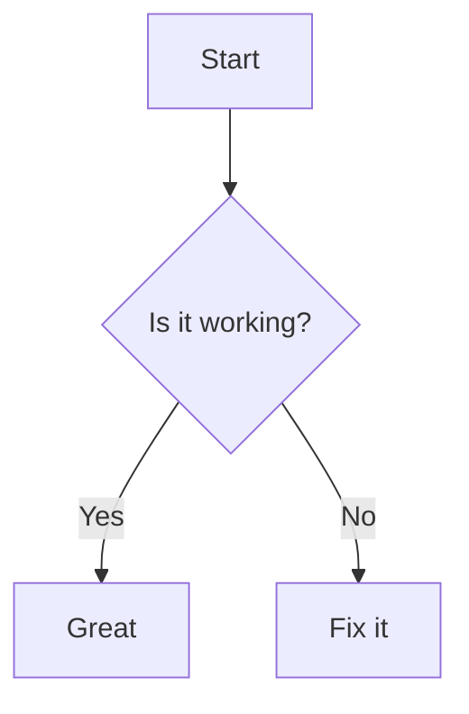

# Mermaid → ASCII

Use this skill whenever you need to render a Mermaid diagram as plain text (for example, to embed in a chat message, markdown file, or terminal output).

The problem this solves: agents often misalign box-drawing characters and spacing when they hand-write ASCII diagrams. This skill never hand-writes ASCII — it feeds valid Mermaid to the `mermaid-ascii` CLI and copies its output verbatim, so the diagram is always correctly aligned.

## How to use

1. Write valid Mermaid diagram code.
2. Run the `scripts/render-mermaid.sh` wrapper in this skill's directory, piping the Mermaid code on stdin (or pass a `.mmd` file as an argument).
3. Copy the script's stdout exactly. Do not re-indent, re-align, or "fix" the output — `mermaid-ascii` produces correctly-aligned output already.

### Pipe Mermaid on stdin (recommended)

```bash
cat > /tmp/diagram.mmd <<'MERMAID'
graph TD
    A[Start] --> B{Is it working?}
    B -->|Yes| C[Great]
    B -->|No| D[Fix it]
MERMAID
./scripts/render-mermaid.sh /tmp/diagram.mmd
```

### Inline (short diagrams only)

```bash
echo 'graph TD; A[Start] --> B{Decision}; B -->|Yes| C[Action]' | ./scripts/render-mermaid.sh
```

## Example

Mermaid input:



ASCII output from `mermaid-ascii` (copy verbatim):

```
┌────────────────┐
│                │
│     Start      │
│                │
└────────┬───────┘
         │
         │
         │
         ▼
┌────────────────┐
│                │
│ Is it working? │
│                │
└────────┬───────┘
         │
         ├──────────────────┐
         │                  │
        Yes                No
         │                  │
         ▼                  ▼
┌────────────────┐     ┌────────┐
│                │     │        │
│     Great      │     │ Fix it │
│                │     │        │
└────────────────┘     └────────┘
```

## Where the script lives

`~/.config/opencode/skills/mermaid-ascii/scripts/render-mermaid.sh`

It requires `mermaid-ascii` on `PATH` (installed at `~/.local/bin/mermaid-ascii`). The wrapper adds `~/.local/bin` to `PATH` itself, then shells out to `mermaid-ascii -f <file> --borderPadding 1`.

## Supported diagram types

Anything `mermaid-ascii` understands: flowcharts (`graph TD`/`LR`), sequence diagrams, class diagrams, state diagrams, and others. If `mermaid-ascii` returns an error, the Mermaid syntax is likely invalid — correct it and retry.

## Rules for the agent

- Never write ASCII diagrams by hand.
- Always run `scripts/render-mermaid.sh` with the Mermaid source.
- Copy stdout verbatim; preserve leading/trailing whitespace and box-drawing characters.
- If the command fails, read stderr, fix the Mermaid, and retry.
